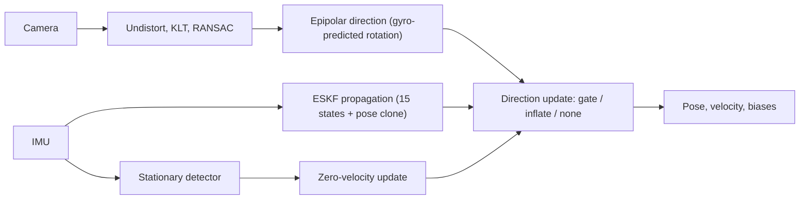

# Visual-inertial odometry on KITTI and EuRoC

A compact visual-inertial pipeline built and evaluated step by step in a Kaggle notebook: sensor loaders with timestamp repair, camera calibration, a KLT front-end, a 15-state error-state EKF with a pose clone, a gyro-aided epipolar camera update, and a zero-velocity update. Every configuration that was tried is reported against ground truth, including the ones that fail.

**Status: research prototype.** The camera update is a two-view relative-pose update, not a multi-view MSCKF, and this is not a reimplementation of OpenVINS. Treat the numbers as an honest record of a small study, not as a benchmark ranking.

## Highlights

- **Inertial drift is severe on a MEMS IMU.** On EuRoC, dead reckoning reaches 77-516 m ATE in 70 s even after static gyro-bias removal. On KITTI's INS-grade IMU the same method gives 0.88 m in 16.5 s.
- **Camera-IMU consistency was checked before any fusion.** On KITTI, vision and gyro rotation agree to a median 0.087 deg per frame (about 0.89 deg of motion). On EuRoC, gyro-predicted rotation cut the epipolar residual from 0.141 deg to 0.019 deg.
- **EuRoC:** the filter beats a never-moving baseline on 3 of 5 sequences and fails on the other 2 (table below).
- **KITTI:** it recovers from a wrong initial velocity on all five drives. From an exact start it is better than IMU-only on two drives and worse on three.
- **Zero-velocity update:** on the only clear stop in the data (KITTI 0011) it cuts end error from 2.2 m to 0.3 m. The thresholds come from that same stop.

## Results

**EuRoC (cleaned copy, 188x120), first 70 s, ATE in metres, 4-DoF aligned.** "Stay still" is the ATE of an estimate that never moves; a result only counts if it beats that.

| sequence | stay still | IMU only | VIO | beats stay-still |
|---|---|---|---|---|
| V1_01_easy | 1.85 | 76.7 | 0.28 | yes |
| V1_02_medium | 1.84 | 516.0 | 1480.5 | no (diverges) |
| V1_03_difficult | 1.74 | 255.1 | 2.42 | no |
| V2_01_easy | 2.06 | 475.0 | 0.80 | yes |
| V2_02_medium | 2.09 | 475.7 | 0.74 | yes |

**KITTI raw, end error in metres (unaligned), default configuration.**

| drive | exact start: IMU only | exact start: VIO | velocity x0.6: IMU only | velocity x0.6: VIO |
|---|---|---|---|---|
| 0005 | 2.9 | 5.1 | 21.9 | 2.1 |
| 0001 | 0.5 | 0.4 | 62.2 | 29.0 |
| 0011 | 2.2 | 3.0 | 119.2 | 84.1 |
| 0014 | 12.7 | 68.4 | 120.0 | 76.2 |
| 0019 | 17.8 | 11.8 | 294.6 | 30.6 |

**Zero-velocity update (sigma_v = 0.2 m/s), end error in metres.** On drive 0011: IMU-only 2.2 to 0.3, VIO 3.0 to 0.2 from an exact start; 119.2 to 10.8 (IMU-only) and 84.1 to 13.2 (VIO) from the x0.6 start. On drive 0019 the detector fired during a slow roll (ground-truth speed up to 0.38 m/s), helped IMU-only (17.8 to 2.4), and worsened VIO (RMSE 5.5 to 7.2).

**Latency** (one run, shared 4-vCPU Intel Xeon 2.0 GHz; repeat runs differed by about 15%):

| pipeline | stage | p50 / p99 |
|---|---|---|
| KITTI 1392x512 | tracker (KLT + RANSAC + detection) | 25.5 / 34.2 ms |
| KITTI 1392x512 | undistort remap | 1.3 / 2.0 ms |
| EuRoC 188x120 | tracker | 3.1 / 3.8 ms |
| EuRoC 188x120 | epipolar direction solve | 0.6 / 1.0 ms |
| ESKF propagation | per IMU sample, NumPy | 159 / 288 us |

The KITTI tracker row excludes the essential-matrix solve and the filter update.

Full grids (every setting, all sequences) are in [`results/tables.md`](results/tables.md); the raw numbers are in `results/results.json`.

## What did not work

- **EuRoC V1_02:** the speed estimate leaves ground truth about 7 s after motion starts and diverges, whatever the outlier handling. The cause is not identified.
- **EuRoC V1_03:** no better than standing still.
- **KITTI 0014:** vision inflates the speed estimate on long straight runs (end error 12.7 m IMU-only, 68.4 m with the default VIO). It matches a persistent pitch error of about 0.5-0.9 deg, but rotating the extrinsics by up to 1 deg about any axis did not fix it.
- **Longer KLT search** did not lengthen KITTI feature tracks; essential-matrix rotation was too noisy at 188x120, so the gyro supplies rotation there; widening the bias priors and modelling the 7 cm lever arm made no measurable difference on EuRoC.

## Pipeline



Both datasets sit behind a `Sequence` object with a time-ordered `replay()` generator, so a live camera and IMU source can replace recorded data later.

## Repository layout

```
vio_kitti_euroc.ipynb   the notebook: source of truth, run top to bottom
pipeline/
  data.py               loaders, timestamp repair, calibration, undistortion
  inertial.py           strapdown integration, gyro relative rotation
  frontend.py           KLT tracker with per-stage timing
  eskf.py               error-state EKF core
  vio.py                filter with pose clone and relative-pose update
  metrics.py            ATE, windowed ATE, alignment
results/                results.json, tables.md, figures
requirements.txt
```

## Data

Not included; see each dataset's licence.

- **KITTI raw**, the `extract` drives (100 Hz OXTS, about 10 Hz camera, unrectified images), downloaded by the notebook from the official KITTI bucket. Ground truth is the OXTS GPS/INS output.
- **EuRoC "cleaned"**, the Kaggle dataset `danylomarchuk/euroc-cleaned`: images downscaled 4x to 188x120, IMU packed as 10 samples per camera interval (timestamps synthesised by even spacing), position-only ground truth. V2_03_difficult is excluded because its frame list and arrays do not match.

## Reproducing

1. Create a Kaggle notebook with internet on and attach the EuRoC dataset above. No GPU is needed.
2. Upload and run `vio_kitti_euroc.ipynb` top to bottom. Some cells write modules into `pipeline/` and later cells patch them in place, so order matters.
3. `pipeline/` in this repo is the final state after those patches. Several pieces (the filter variants, `run_vio`, the zero-velocity update, the direction solver) still live only in notebook cells, and paths are Kaggle-specific.

Runs are deterministic: spot-checked numbers reproduced exactly after a re-run.

## Limitations

- **Everything is in-sample.** All settings were chosen after seeing the same five EuRoC and five KITTI sequences; there is no held-out set. The full grids are published so the choices are visible.
- KITTI runs are 12-50 s and start from ground truth. KITTI ground truth comes from the same GPS/INS unit that supplies the IMU data.
- The EuRoC copy has no attitude ground truth, so attitude is not evaluated.
- IMU noise values come from the still period of one EuRoC sequence and probably include platform vibration.
- Zero-velocity thresholds were fitted on the single stop used to evaluate them. Only drive 0011 has a clear stop, and the stationary detector cannot be validated on EuRoC.

## Roadmap

- Multi-view (MSCKF-style) update over whole feature tracks
- Online estimation of the camera-IMU rotation and time offset
- C++ implementation of propagation and tracking with unit tests, using the numbers above as the baseline
- Full-resolution EuRoC with attitude ground truth, to test the tilt-error explanation for V1_02
- Retrieval and vision-language layers on keyframes (planned, not implemented)

## Paper

A draft write-up lives in `paper/` 

## References

Geiger et al., "Vision meets robotics: The KITTI dataset" (IJRR 2013). Burri et al., "The EuRoC micro aerial vehicle datasets" (IJRR 2016). Mourikis and Roumeliotis, "A multi-state constraint Kalman filter for vision-aided inertial navigation" (ICRA 2007). Geneva et al., "OpenVINS: A research platform for visual-inertial estimation" (ICRA 2020). Verify the full citations before publishing.
